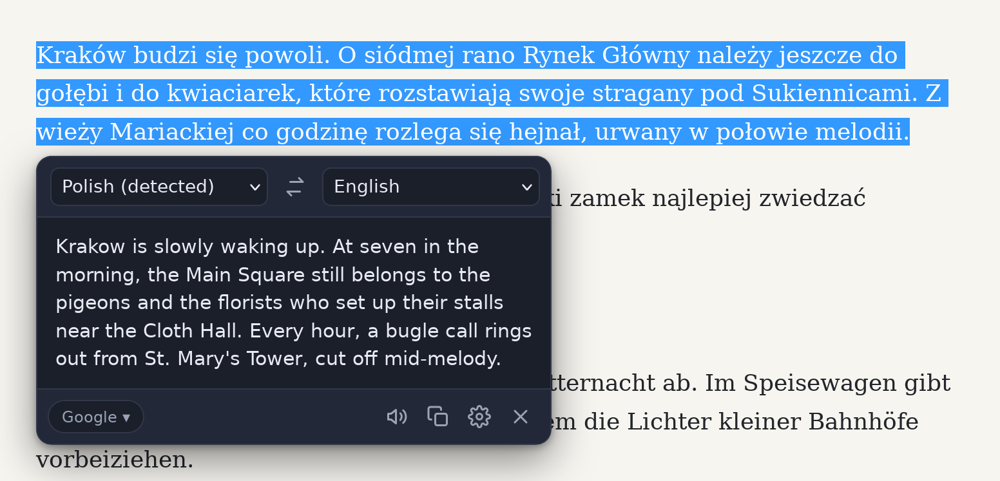
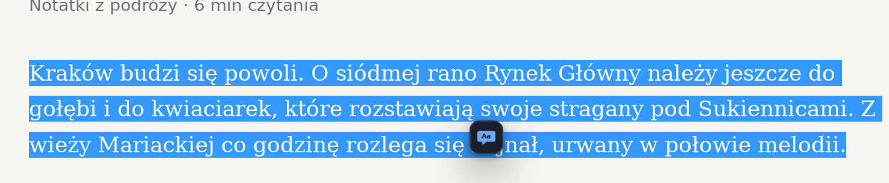
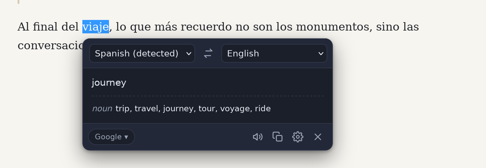
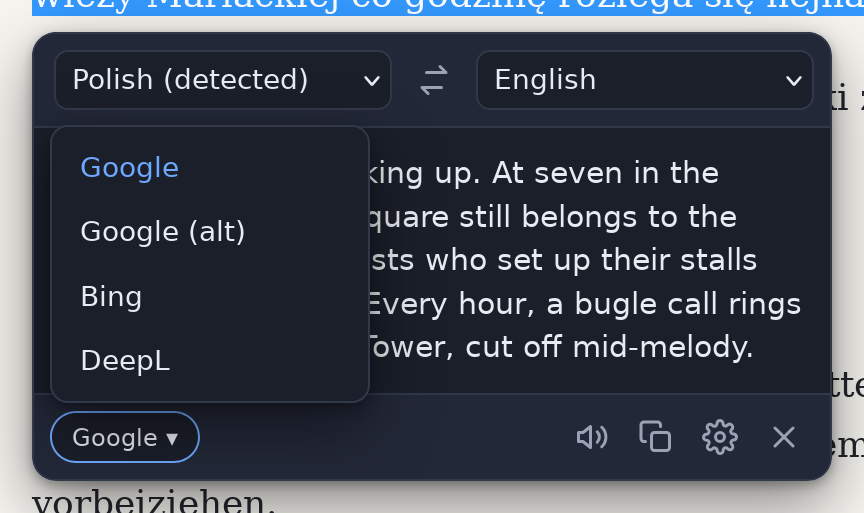
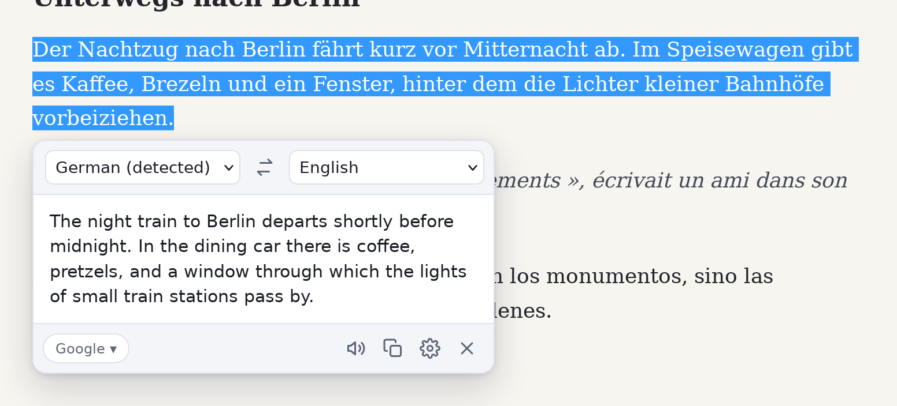
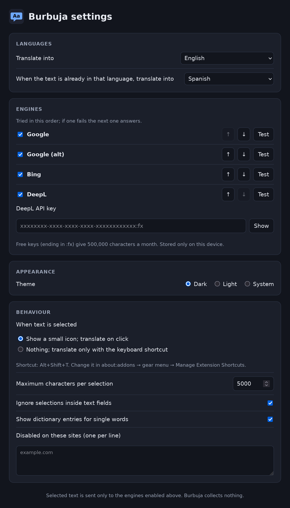

<h1 align="center">Burbuja</h1>

<p align="center">
  Translate selected text in a bubble, in <b>Firefox</b> and <b>Zen</b>.<br>
  Select text on any page, click the small icon, read the translation. Dark by default, nothing collected.
</p>

<p align="center">
  <a href="https://github.com/akunito/burbuja/releases/latest"></a>
  
  
  <a href="LICENSE"></a>
</p>

> **Built on [Simple Translate](https://github.com/sienori/simple-translate) and [TWP – Translate Web Pages](https://github.com/FilipePS/Traduzir-paginas-web).** The engine adapters (how to talk to Google's and Bing's free endpoints) are derived from those two MPL-2.0 projects; the bubble, the options page and the fallback chain are Burbuja's. If an engine stops answering, those projects are usually the first place a fix shows up: star and support them too.

<p align="center">
  
</p>

> The article in these pictures is a made-up demo page from the test suite; the translations are real answers from Google Translate.

## What this is

Burbuja is a small browser extension that translates **what you select**, where you are reading it. No new tab, no copy and paste, no page rewritten: a bubble opens next to the text and closes with <kbd>Esc</kbd> or a click outside.

It uses the **free Google Translate endpoints** first and falls back to **Bing** by itself when Google does not answer; **DeepL** joins the chain if you give it your own free API key. There is no Burbuja server, no account and no telemetry: the text you select goes only to the translation engines you enable, and nothing else leaves your browser.

Licence: **MPL-2.0**, the same as the projects the engine code comes from.

## Download

**[⬇ Latest release](https://github.com/akunito/burbuja/releases/latest)** — two files per release:

- **Firefox / Zen**: `burbuja-<version>.xpi`, signed by Mozilla (AMO, unlisted). This is the one to install.
- **Chrome**: `burbuja-chrome-<version>.zip`, an unpacked Chrome build. It is not published on the Chrome Web Store; load it yourself from `chrome://extensions` → *Developer mode* → *Load unpacked* if you want to try it.

## Features

- **Translate a selection** — select text, click the small icon that appears next to it, and the bubble shows the translation. Or skip the icon and use <kbd>Alt</kbd>+<kbd>Shift</kbd>+<kbd>T</kbd>.
- **Source language detected** ("Polish (detected)") and changeable in the bubble if the guess is wrong; the text is translated again at once.
- **Target language** — your browser's language by default, changeable in the bubble or in the options. A **second language** takes over when the text is already in your target language (English by default).
- **Swap** — one click turns it around and translates the result back.
- **Engines with automatic fallback** — Google → Google (alt) → Bing → DeepL. If one fails the next one answers; the chip at the bottom says which one did, and its menu re-runs the text with another engine.
- **Dictionary for single words** — select one word and you also get its meanings by part of speech.
- **Listen** (Google text-to-speech) and **copy** the translation.
- **Dark, light or system theme**; the page's own styles never leak into the bubble.
- **Excluded sites**, a maximum selection length, and selections inside text fields ignored by default.
- **Interface in English, Spanish and Polish**, following the browser.

## Requirements

- **Firefox 140 or newer**, or **Zen** (current versions are fine). Firefox for Android 142+ is accepted by the manifest but not tested.
- An internet connection: the translation itself is done by Google, Bing or DeepL.

## Installation

1. **Download `burbuja-<version>.xpi`** from the [latest release](https://github.com/akunito/burbuja/releases/latest).
2. **Open it with Firefox or Zen**: clicking the downloaded file is usually enough; otherwise drag it onto a browser window, or *about:addons* → gear menu → *Install Add-on From File…*.
3. **Accept the prompt.** The browser shows the permissions: access to the translation sites and that the text you select is sent to translation services. Click *Add*.

Updates arrive by themselves: the browser checks `updates.json` on this repository's GitHub Pages and installs new signed versions like any other add-on.

## Using it

<table>
  <tr>
    <td width="50%"><br><sub><b>Select</b> — the small icon appears next to the selection; click it</sub></td>
    <td width="50%"><br><sub><b>One word</b> — the translation plus its dictionary entries</sub></td>
  </tr>
  <tr>
    <td width="50%"><br><sub><b>Engine menu</b> — re-run the same text with another engine</sub></td>
    <td width="50%"><br><sub><b>Light theme</b> — dark, light, or follow the system</sub></td>
  </tr>
</table>

| | |
|---|---|
| select text, click the icon | open the bubble |
| <kbd>Alt</kbd>+<kbd>Shift</kbd>+<kbd>T</kbd> | translate the selection without the icon (change it in *about:addons* → gear menu → *Manage Extension Shortcuts*) |
| source / target menus | change the detected language or the target; the text is translated again |
| ⇄ | swap the languages and translate the result back |
| engine chip (*Google ▾*) | which engine answered; its menu re-runs the text with another one |
| 🔊 | listen to the translation |
| ⧉ | copy the translation |
| ⚙ | open the options |
| <kbd>Esc</kbd>, a click outside, or ✕ | close the bubble |

## Engines and fallback

Burbuja tries the engines in the order set in the options, and moves to the next one when an engine fails (network error, block, rate limit):

1. **Google** — Google Translate's web endpoint (`translate-pa.googleapis.com`), no key.
2. **Google (alt)** — the older keyless `gtx` endpoint, used when the first one fails.
3. **Bing** — Microsoft Translator through the endpoint Microsoft Edge uses, no key.
4. **DeepL** — only with **your own DeepL API key**; the free plan gives 500,000 characters a month. Without a key it is skipped.

The Google and Bing endpoints are free and unofficial: they can change without notice, which is exactly why the chain exists. Each engine can be switched off, moved up or down, and checked with its **Test** button in the options.

## Options

*about:addons* → Burbuja → *Options* (Preferences), or the ⚙ button in the bubble. Every change saves itself.

<p align="center">
  
</p>

- **Languages** — *Translate into* (default: the browser's language) and *When the text is already in that language, translate into* (default: English; *Off* to disable).
- **Engines** — enable, order and test each engine; the **DeepL API key** is stored only on this device (`storage.local`, never synced).
- **Appearance** — theme: dark (default), light or system.
- **Behaviour** — when text is selected: show the small icon, or nothing and translate only with the shortcut; maximum characters per selection (5000); ignore selections inside text fields; show dictionary entries for single words; sites where Burbuja is disabled (one per line).

## Privacy

Burbuja collects **nothing**: no statistics, no analytics, no account, no server of its own. Settings stay in your browser.

The text you select is sent only to the translation engines you have enabled, and only when you ask for a translation:

- **translate-pa.googleapis.com**, **translate.googleapis.com** — Google Translate (and **translate.google.com** for text-to-speech when you press listen).
- **edge.microsoft.com** — the Bing fallback.
- **api-free.deepl.com** / **api.deepl.com** — only if you entered a DeepL key.

Those services have their own privacy policies. Do not translate text you would not paste into Google Translate yourself; add sites where you never want the icon to *excluded sites*.

## FAQ

**The icon does not appear.**
Check that the site is not in *excluded sites* and that *When text is selected* is set to *Show a small icon*. Selections inside text fields are ignored by default. Browser pages (about:, the add-ons store, `file://` pages in Zen) do not allow extensions to run.

**The chip says Bing instead of Google.**
Google did not answer (blocked network, rate limit, endpoint changed), so the next engine did. Nothing to do; if it keeps happening, *Options → Engines → Test* shows which engines work from your connection.

**Do I need a DeepL key?**
No. Google and Bing need no key. DeepL is optional and only used with your own free key from deepl.com.

**Burbuja stopped working and is missing from about:addons.**
Open the signed `.xpi` from the [latest release](https://github.com/akunito/burbuja/releases/latest) again and accept the install. Do not remove the add-on first: reinstalling keeps your settings and DeepL key, removing deletes them. This happens when a temporary copy with the same id (loaded from `about:debugging`) was active while the signed one was installed and the browser then closed without a clean shutdown (power off, crash): Firefox only re-shows the installed copy when the temporary one is removed during a clean shutdown.

**Listen does not play.**
It uses Google's text-to-speech and falls back to the browser's own speech voices when Google does not start playing within 2 seconds. Check that the tab is not muted.

## Building from source

Nothing runs on the host: every npm command goes through a throwaway `node:22-bookworm` container.

```bash
./scripts/npm ci
./scripts/npm run build      # .output/firefox-mv2 and .output/chrome-mv3
./scripts/npm test
./scripts/npm run lint:ext   # web-ext lint on the Firefox build
```

Load the Firefox build temporarily from `about:debugging` → This Firefox → Load Temporary Add-on → `.output/firefox-mv2/manifest.json`. Do this in a separate test profile, not in the profile where the signed build is installed: a temporary copy with the same id hides the installed one, and if the browser then ends without a clean shutdown the installed copy stays hidden and disabled (measured on Zen 1.22.1b; fix in the FAQ).

### Tests

```bash
./scripts/npm test           # unit tests on captured engine responses
./scripts/npm run smoke      # live canary against Google/Bing/TTS
./scripts/e2e                # real input in Zen (headless, throwaway profile, host Zen from /nix)
E2E_BLOCK_GOOGLE=1 ./scripts/e2e   # Google unreachable → fallback must answer
./scripts/e2e screenshots    # regenerates docs/screenshots/ (not part of the suite)
```

### AMO reviewers

Requirements: Node 22 and npm 10 (or Docker). From the unpacked source archive:

```bash
npm ci
npx wxt build -b firefox     # output: .output/firefox-mv2
```

The same with Docker only: `docker run --rm -v "$PWD:/app" -w /app node:22-bookworm sh -c 'npm ci && npx wxt build -b firefox'`.

Repository layout:

| | |
|---|---|
| `entrypoints/background.ts` | engine chain, messages from the bubble and the options page, shortcut |
| `entrypoints/content/` | the selection icon and the bubble (Preact, closed shadow root) |
| `entrypoints/options/` | the options page |
| `src/engines/` | Google, Bing and DeepL adapters and the fallback chain |
| `public/_locales/` | interface strings (en, es, pl) |
| `tests/` | unit tests, live smoke canary, Zen e2e (`tests/e2e`) |
| `scripts/` | docker wrappers for npm/npx and the e2e runner |

Issues and pull requests are welcome here. Fixes to the free Google or Bing endpoints are worth sending upstream too, to [Simple Translate](https://github.com/sienori/simple-translate) and [TWP](https://github.com/FilipePS/Traduzir-paginas-web).

## Credits and licence

- **[Simple Translate](https://github.com/sienori/simple-translate)** (sienori) — MPL-2.0; the Google translation adapter is derived from it.
- **[TWP – Translate Web Pages](https://github.com/FilipePS/Traduzir-paginas-web)** (FilipePS) — MPL-2.0; the Bing (Edge endpoint) adapter and the Google text-to-speech endpoint come from it.
- Translations by Google Translate, Microsoft Translator and DeepL, through their public endpoints; Burbuja is not affiliated with any of them.

Burbuja is distributed under the **MPL-2.0**; the full text is [`LICENSE`](LICENSE).
